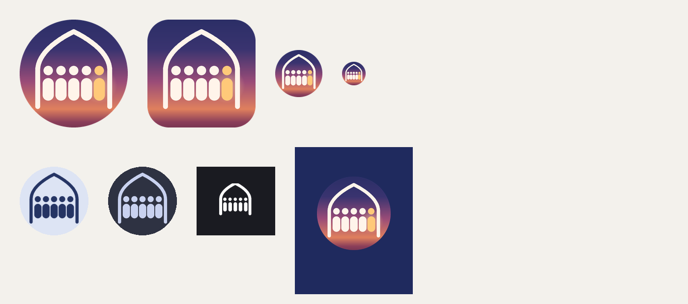

# Jama’ah icon: Saff + Mihrab (A)

Approved by the owner on 2026-10-16. The row of worshippers stands inside the arch of their
mosque, shoulder to shoulder; the last figure, lit amber, is you taking your place. It replaces
the placeholder icon, the crescent status-bar icon and the plain splash.



Top row: launcher icon (circle and rounded-square masks, 96 px, 48 px). Bottom row: themed icon
(Android 13+, light and dark wallpaper), status-bar icon, Android 12 splash.

## What is here

| Path | What it is |
|---|---|
| `android/res/mipmap-anydpi-v26/ic_launcher.xml`, `ic_launcher_round.xml` | Adaptive icon (background + foreground + monochrome) |
| `android/res/drawable/ic_launcher_background.xml` | Sky gradient layer (108 dp) |
| `android/res/drawable/ic_launcher_foreground.xml` | Arch, five figures, glow behind the lit one (108 dp) |
| `android/res/drawable/ic_launcher_monochrome.xml` | Single-colour layer for Android 13 themed icons |
| `android/res/drawable/ic_stat_jamaah.xml` | Status-bar icon: white, the arch and all five figures, drawn slimmer (head r 2.6, body 5.6 wide, arch stroke 4.5) so the gaps stay open at 24 dp. Compare: `png/status-bar-compare.png` |
| `android/res/drawable/splash_icon.xml` | Android 12+ splash icon (288 dp, same geometry) |
| `android/res/values/brand_colors.xml` | `brand_splash` #1F2A5E, `brand_cream` #FFF4EA, `brand_amber` #FFC979 |
| `android/res/mipmap-*/ic_launcher*.png` | Legacy launcher PNGs for Android below 8.0 |
| `png/playstore-512.png` | Google Play icon (512 × 512, full bleed, no rounding: Play masks it) |
| `svg/*.svg` | Masters: full icon, each layer, the status-bar icon, and the in-app mark (`mark.svg` tinted with `currentColor`, lit figure amber; `mark-mono.svg` all one colour) |
| `make_brand.py` | The single source of every file above. Change the geometry there and re-run: `python -E -P make_brand.py .` (needs Pillow and NumPy) |

## Setting it up (Android)

1. Copy `android/res/**` into `android/app/src/main/res/`, replacing the old `mipmap-*/ic_launcher.png`
   and `drawable/ic_stat_jamaah.xml`. The status-bar icon keeps its name, so the notification code
   doesn’t change.
2. `AndroidManifest.xml`: `android:icon="@mipmap/ic_launcher"` and add
   `android:roundIcon="@mipmap/ic_launcher_round"`.
3. Splash, Android 12+: add `values-v31/styles.xml` (and `values-night-v31`) for `LaunchTheme`:
   ```xml
   <item name="android:windowSplashScreenBackground">@color/brand_splash</item>
   <item name="android:windowSplashScreenAnimatedIcon">@drawable/splash_icon</item>
   ```
   Same colour in light and dark: the splash is the evening sky either way.
4. Splash before Android 12: `drawable/launch_background.xml` (and `drawable-v21`) becomes a
   layer-list of `@color/brand_splash` with `@drawable/splash_icon` centred (vector drawables
   in a layer-list need API 23+; below that keep the plain colour).
5. Check on the A53: launcher with different icon shapes, themed icons on (Settings → Wallpaper
   and style → Themed icons), a notification in the shade, the splash in light and dark.

## In the app

- The old “Jama’ah” wordmark at the top of the app is gone in the Horizon design; the mark is
  used in onboarding (welcome step), About, and anywhere a logo is needed.
- Draw it in Flutter from the geometry below (no new package needed: the path strings are the
  same SVG path syntax the app already parses for Lucide icons). Tint the arch and four figures
  with the current ink; keep the fifth figure amber #FFC979, or the same ink where one colour is
  required.
- **Lockups:** English: mark, then “Jama’ah” in Fraunces 400, mark height = 1.3 × the text’s
  cap height, gap = 0.35 × mark height. Arabic: mirrored, mark on the right, «جماعة» in Noto Naskh
  Arabic 600. Never stretch the mark or recolour the lit figure to anything but amber or the ink.

## Geometry (108-unit adaptive grid; launcher shows 18–90; safe circle r 33 at 54,54)

- Background: vertical gradient #1F2A5E 0 · #3A3470 .35 · #9A4C78 .55 · #E0805E .72 ·
  #8A3E5A .80 · #2A1630 1.
- Arch: `M30,76 V52 C30,40 44,31 54,26 C64,31 78,40 78,52 V76`, stroke 3.2, round caps and joins,
  #FFF4EA (status bar: stroke 4.5).
- Figures at x = 37, 45.5, 54, 62.5 (cream) and 71 (amber, “you”): head circle r 3.1 at y 52;
  body capsule 7.4 × 15 from y 57. The status-bar icon keeps the same positions with head r 2.6
  and body 5.6 wide.
- Glow: radial #FFD9A0 at 60% → 0, centre (71, 62), r 12, full-colour icon only.

## Optional later: animated splash (Android 12+, ≤ 1000 ms)

The design canvas animates it: the arch draws itself (≈ 520 ms), the four figures appear left to
right (60 ms apart), then you slide in from the right (≈ 620 ms from 800 ms). As an
`animated-vector` it is a `trimPathEnd` on the arch plus alpha/translate on five groups. Not
needed for the first release; the static splash above is complete.
